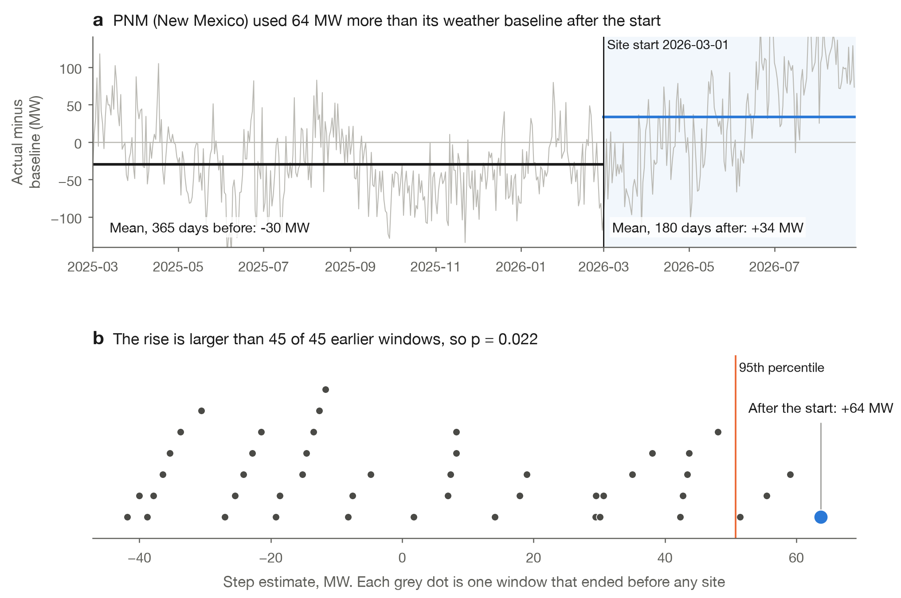

# AI Power Atlas

[](https://github.com/VijayChamakuri/ai-power-atlas/actions/workflows/ci.yml)
[](https://www.python.org/downloads/release/python-3120/)
[](LICENSE)

Vijay Shankar Chamakuri

I test whether one AI data center is large enough to see in a US grid operator's hourly electricity demand, and whether demand jumped after one campus was listed as starting.

The demand series are the US Energy Information Administration's Form 930 (EIA-930). Campus sizes and dates are from Epoch AI, and weather is from Open-Meteo. The detectability inputs are frozen on 31 October 2026.

On Public Service Company of New Mexico (PNM), demand in the 180 days after Meta's Los Lunas campus was listed as starting sat 64 megawatts (MW) above a weather baseline, higher than all 45 earlier windows on that grid.

<p align="center"></p>

Early event study, from the snapshot frozen on 1 November 2026. The detectability freeze is the day before. The flat lines are the mean residual before the listed start (-30 MW) and after it (+34 MW). The estimate is the difference, rounded to the nearest MW, which is also how the chart labels it.

| | Los Lunas on PNM |
|---|---|
| Step estimate | +64 MW |
| 90% interval | +13 to +102 MW |
| Pre-site windows beaten | 45 of 45 |
| Rank p | 0.022 |
| Epoch power for this window | 114 MW |

64 MW is the measured rise. 114 MW is Epoch's listing for the March 2026 window, and 147 MW is the same campus on the 31 October 2026 list.

The baseline is the demand predicted from the calendar and the weather. The step estimate is the average miss in the 180 days after a date, minus the average miss in the year before it. Rank p is where that estimate sits among the earlier windows on the same grid.

The rise beat every one of those earlier windows. It is smaller than the 114 MW Epoch listed for the campus, and a higher residual does not show that the campus caused it.

## How it works

### Which campuses are even testable

A balancing authority (BA) keeps supply and demand matched on one part of the grid. I test a BA only when its listed campuses are large next to its peak, and a campus only when it sits in one grid boundary, has no on-site generation flag, and clears that grid's detection limit. Two of 60 sites pass, holding 345 of 15,835 MW: Meta Kuna on Idaho Power and Meta Los Lunas on PNM. The cutoffs are in [docs/METHODOLOGY.md](docs/METHODOLOGY.md), and the code is [`select_candidates`](src/atlas/ml/candidates.py) and [`go_test`](src/atlas/ml/detectability.py).

### Weather baseline

I want the jump, not the weather. A straight line is fit on the training window, [LightGBM](https://lightgbm.readthedocs.io/) fits what is left, and the line is added back, because a tree cannot extrapolate a trend and a missing trend would look like new load. There is no lagged demand. The features and the hour filter are in [docs/METHODOLOGY.md](docs/METHODOLOGY.md), and the fit is [`src/atlas/ml/baseline.py`](src/atlas/ml/baseline.py).

### Detection limit

The same step is scored on many dates, and the last window has to end before the grid's first listed site, so the real campus stays out of the noise. The detection limit is how far those estimates wander. The spacing and the percentiles are in [docs/METHODOLOGY.md](docs/METHODOLOGY.md). [`step_estimate`](src/atlas/ml/detectability.py) is:

```python
def step_estimate(daily_residuals: pd.Series, t: date) -> float:
    """Mean residual in the 180 days after t, minus the mean in the 365 days before it."""
    moment = pd.Timestamp(t, tz="UTC")
    pre = daily_residuals[
        (daily_residuals.index >= moment - pd.Timedelta(days=PRE_DAYS))
        & (daily_residuals.index < moment)
    ]
    post = daily_residuals[
        (daily_residuals.index >= moment)
        & (daily_residuals.index < moment + pd.Timedelta(days=POST_DAYS))
    ]
    return float(post.mean() - pre.mean())
```

### Event study

The same estimator is applied at the real start date and ranked against that grid's own pre-site windows. The two primary sites share one 5% error budget, so the early Los Lunas run has to clear a tighter line than a one-site test. The code raises before 15 December 2026, and the early path opens only for Los Lunas, once. Scoring and the locks are in [`src/atlas/ml/event_study.py`](src/atlas/ml/event_study.py), and the committed rules are [docs/analysis_plan.md](docs/analysis_plan.md).

## Design decisions

| Choice | Why | Cost |
|---|---|---|
| Untuned LightGBM defaults | Tuning on the pre-site windows would shrink the limit | A weaker short-range forecast than EIA's day-ahead on most grids |
| Fit a line, then trees on the remainder | Trees cannot extrapolate, and a flat trend would look like new load | A trend that is not a straight line stays in the residual |
| No lagged demand, and training stops a year before the test date | A lag, or training through the jump, would hide it | The baseline cannot use yesterday's demand |
| Limits use only windows that end before the first listed site | The real campus stays out of the noise estimate | Fewer windows, so each limit is rough |
| Inputs are stored under the freeze date | A later download cannot change a published result | A new question needs a new snapshot |
| The event study will not run before 15 December 2026 | A result computed early cannot be unseen | Meta Kuna waits. Los Lunas already had its one early run |
| The warehouse recomputes the verdicts in SQL, its query language | The build fails if those queries and Python disagree | Two copies of each rule |

## Evaluation

`make ci` runs the linters, mypy in strict mode, sqlfluff, pytest with the network blocked, and a dbt build. dbt builds the DuckDB warehouse. pytest is 128 passed. dbt on the real slice in [`tests/fixtures/lake`](tests/fixtures/lake) is 109 passed (24 models, 81 data tests, 4 seeds), against 97 on the full-lake build in [docs/log.md](docs/log.md).

- Estimator, go rule, and locks: [`tests/unit/test_detectability.py`](tests/unit/test_detectability.py) and the event-study tests next to it.
- Ingest and recorded source responses: [`tests/unit/`](tests/unit/) and [`tests/fixtures/cassettes`](tests/fixtures/cassettes).
- The app recomputes the stored step: [`tests/unit/test_app.py`](tests/unit/test_app.py).
- The warehouse fails if its queries disagree with Python: [`dbt/tests`](dbt/tests).

## Limitations

- A jump in the residual is not a cause. Another new customer on the same date would look the same.
- Epoch's power and start dates are estimates from imagery and permits, not meters.
- The limit assumes a step on one day. A slow ramp is easier to miss, and the limits on PJM (the Mid-Atlantic grid, 3,803 MW), ERCOT (most of Texas, 2,675 MW), and Southern Company (1,678 MW) sit above every listed site there.
- EIA-930 revises recent hours. Shifting the Los Lunas start 90 days later still needs data through 25 November 2026, and the rank p is as small as 45 comparison windows can make it.

## What I'd do next

- Score Meta Kuna on the 15 December 2026 snapshot and assign both labels together. `make m2` already refuses to start before that date, and the Los Lunas estimate stays fixed when that run happens.
- Add the 90-days-later shift, and report how far EIA's revisions move the 64 MW estimate. Both need that later snapshot.
- Meta-QTS Hillsboro 2 is out only because the boundary polygons overlap. On the October list it is 243 MW against Portland General's 44 MW limit. The event-study amendment uses 61 MW, the power at the August 2023 start, because the 243 MW figure comes later. Adding the site would be a dated amendment with a cited serving utility, not a change to this result.

## Run it

You need git, make, uv, and Python 3.12.

```bash
git clone https://github.com/VijayChamakuri/ai-power-atlas.git
cd ai-power-atlas
make setup
make ci
make app
```

`make setup` copies [`.env.example`](.env.example) if you do not already have a `.env`. `make ci` and `make app` do not need a key or Docker. `make app` serves the page at <http://localhost:8501> from the files in [`app/data`](app/data). A fresh pull, the local services and their ports, and restoring the frozen lake are in [Reproduce this](docs/paper.md#reproduce-this).

## Repository map

| Path | What it holds |
|---|---|
| [`src/atlas/ml/detectability.py`](src/atlas/ml/detectability.py) | Detection limit, step estimate, and the go test |
| [`src/atlas/ml/event_study.py`](src/atlas/ml/event_study.py) | Event-study score and the date locks |
| [`src/atlas/ml/baseline.py`](src/atlas/ml/baseline.py) | Detrended LightGBM baseline |
| [`src/atlas/config.py`](src/atlas/config.py) | Freeze dates, windows, and model settings |
| [`src/atlas/ingest/`](src/atlas/ingest/) | Pulls for EIA-930, Epoch, weather, and site locations |
| [`dbt/`](dbt/) | DuckDB models and the SQL checks against Python |
| [`dags/`](dags/) | Airflow: full rebuild, hourly EIA pull, locked event study |
| [`app/`](app/) | Streamlit page and the four CSV files it reads |
| [`tests/`](tests/) | Pytest, recorded HTTP responses, and the lake slice |
| [`docs/paper.md`](docs/paper.md) | Working paper, also rendered as [`docs/paper.pdf`](docs/paper.pdf) |
| [`docs/analysis_plan.md`](docs/analysis_plan.md) | Method committed before the fits, plus dated amendments |
| [`docs/RESULTS.md`](docs/RESULTS.md) | Stored values, intervals, and the other grids |
| [`docs/METHODOLOGY.md`](docs/METHODOLOGY.md) | Windows, features, and model settings |
| [`docs/m1_detectability.md`](docs/m1_detectability.md) | Generated per-grid and per-site table |
| [`docs/m2_early_los_lunas.md`](docs/m2_early_los_lunas.md) | Generated early-run table |
| [`docs/log.md`](docs/log.md) | Build log, input hashes, and differences from the plan |
| [`Makefile`](Makefile) | `setup`, `ci`, `pipeline`, `app`, and the locked M2 commands |
