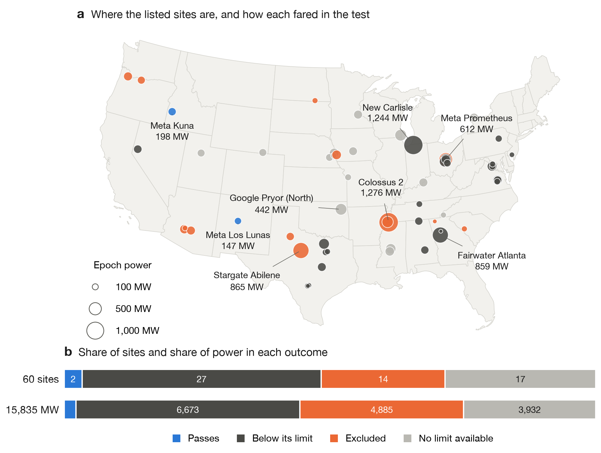
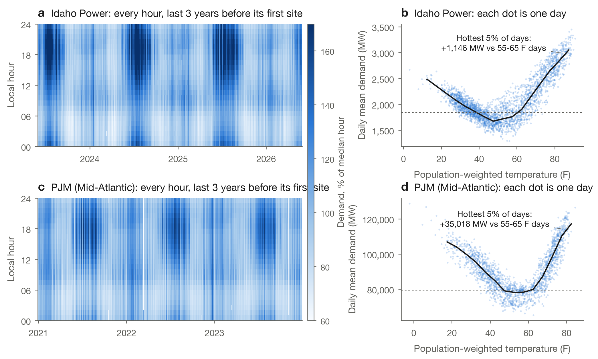
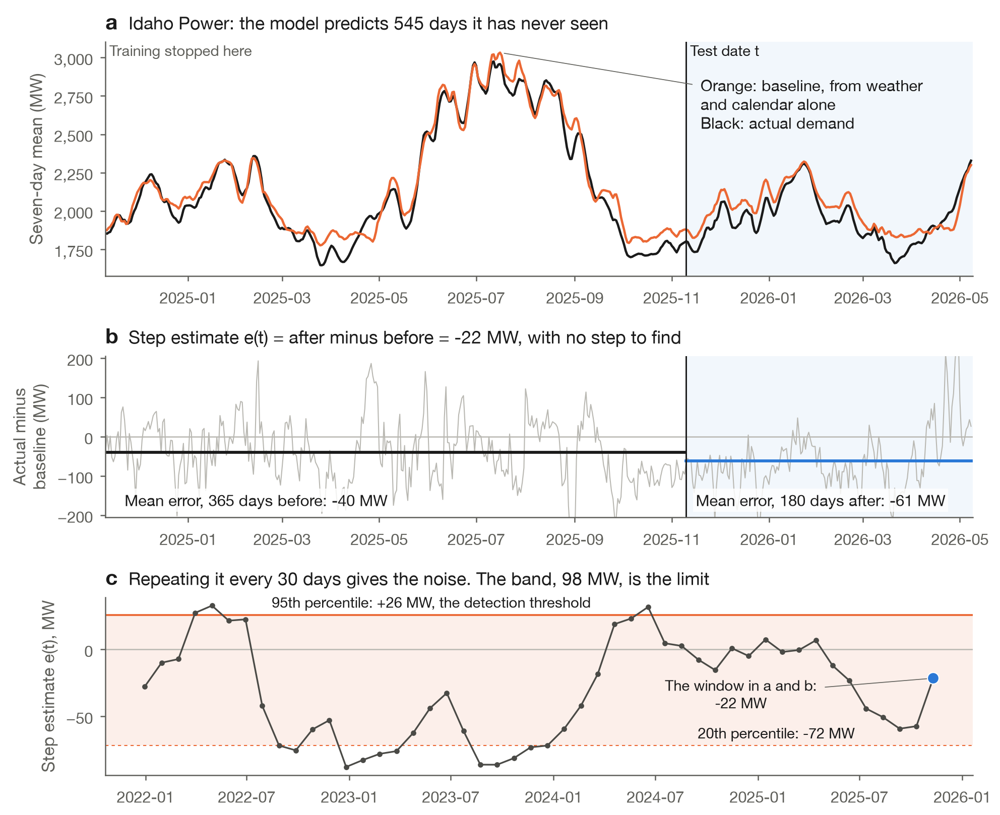
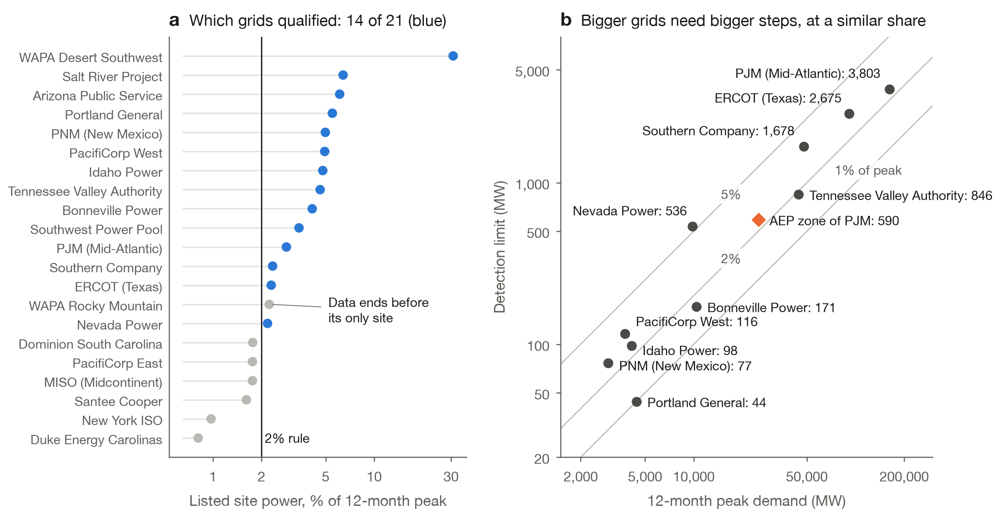
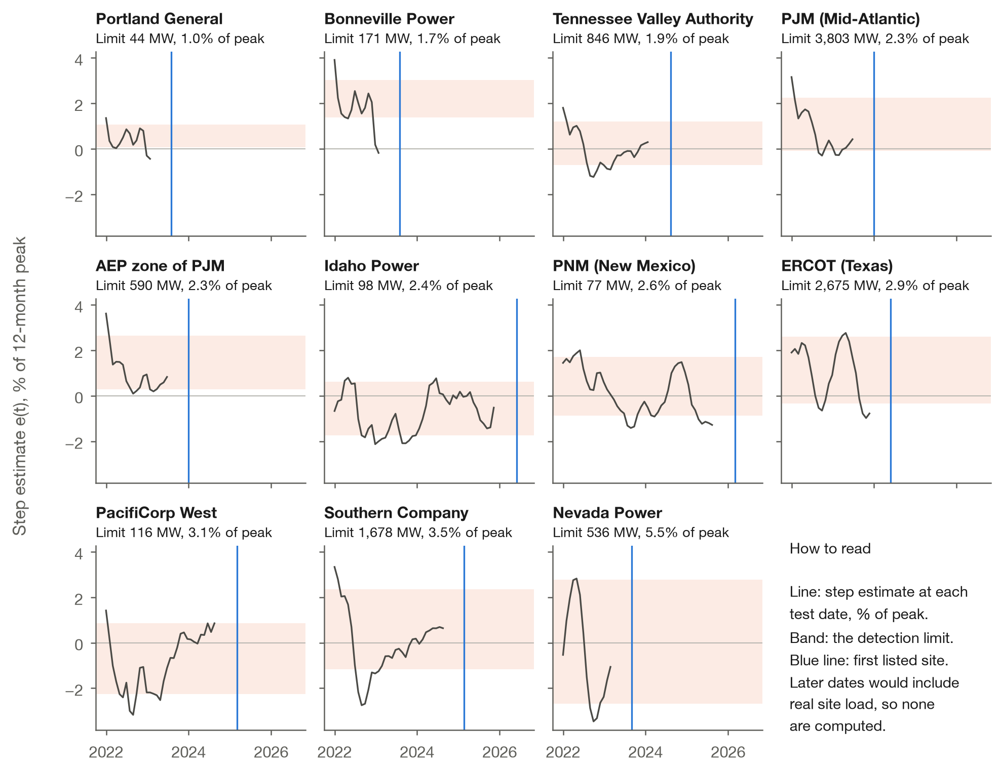
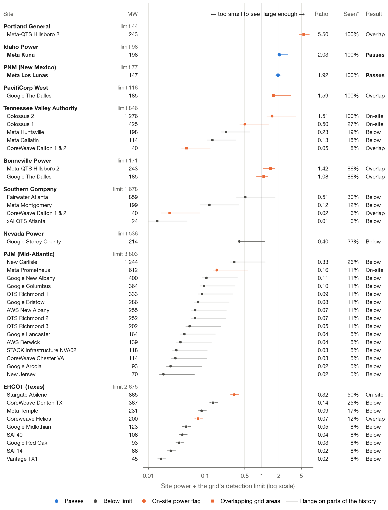
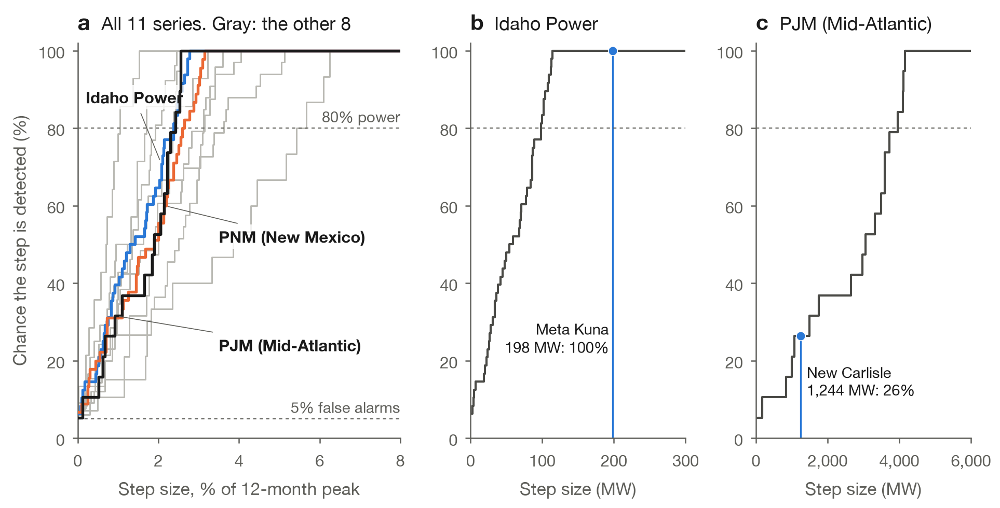
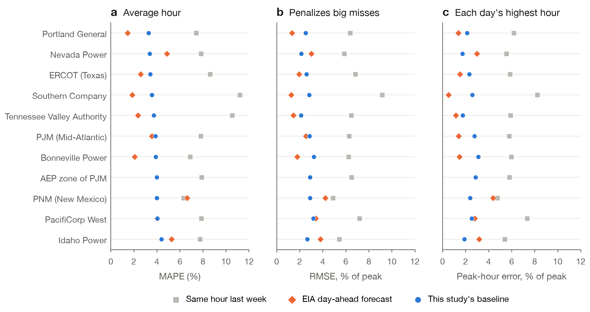

# Can a Single AI Data Center Be Seen in US Grid Demand?

### A pre-registered detectability study of 60 sites and 14 balancing authorities

**Vijay Shankar Chamakuri** · Working paper, feasibility stage (M1) · Data frozen 2026-10-31

[Download as PDF](docs/paper.pdf)

> **Status: no finding yet.** This study measured what the public data *could* reveal. It has not
> measured any data center's actual effect on the grid. That test is the next stage, and it has not
> started.

---

## In plain English

Imagine trying to tell, from your home's electricity bill alone, whether a neighbor plugged a space
heater into your outlet. If your bill swings by hundreds of dollars with the seasons, a heater adds too
little to notice. If your bill barely moves, you would spot it right away.

The US grid works the same way. Each regional grid operator, called a **balancing authority**, publishes
its electricity demand every hour. AI data centers now draw hundreds of megawatts, and some more than a
gigawatt. People often assume that this new demand must be obvious in the data. But a heat wave can add
far more demand than a data center does.

So before asking "did this data center change demand?", this study asks a prior question: **if it did,
could we even tell?** It found three things:

1. **Mostly no, for one site at a time.** Of 60 listed US sites with power by October 2026, only **2**
   pass the test. Together they hold 345 of the 15,835 MW in the list.
2. **Size of the grid matters more than size of the campus.** A 147 MW site in New Mexico can be seen. The
   1,244 MW New Carlisle campus cannot be seen in PJM's total, because PJM's demand is so large that its
   normal swings would hide it.
3. **The rules were written first.** The method was committed to git before any model ran, so it could not
   be adjusted to reach a preferred answer.

---

## Abstract

Attributing electricity demand growth to AI data centers requires knowing how small a change hourly grid
data can reveal. We estimate a minimum detectable step for 11 demand series from EIA-930 for 2019-2026,
using an untuned, weather-normalized LightGBM baseline scored strictly out of sample and only on windows
that end before each balancing authority's first listed site. Of 21 balancing authorities holding sites
listed by Epoch AI, 14 met a pre-registered 2% share rule, and 10 of those had enough history for an
estimate. Detection limits ran from 1.0% to 5.5% of 12-month peak demand. Two sites without disqualifying
flags cleared their limits: Meta Kuna (198 MW against 98 MW in Idaho Power) and Meta Los Lunas (147 MW
against 77 MW in New Mexico's PNM). No eligible site cleared its limit in PJM, ERCOT, or Southern Company, where the
limits were 3,803, 2,675, and 1,678 MW. In a secondary analysis, New Carlisle (1,244 MW) cleared the 590
MW limit of PJM's smaller AEP zone. These results support a narrow event study in small balancing
authorities and suggest that single-campus claims at the level of a large market need stronger evidence.
No effect of any site has been estimated.

---

## 1. Introduction

Demand from AI data centers is a common explanation for rising load forecasts. Testing that claim in
observed data is harder than it looks. Hourly demand moves with weather, the calendar, and other
customers, and any new campus arrives on top of those movements. An event study applied to a site that is
too small to detect gives a null result that means nothing, and a positive result could easily be noise.

Statisticians handle this by calculating power before running a test. This paper does that for grid
demand. It asks what size of sudden, lasting step in demand each series could reveal, using a 5% false
positive rate and 80% power, and it compares that limit with each listed site.

Three design choices protect the result:

- **Pre-registration.** The [analysis plan](docs/analysis_plan.md) was committed before any model was fit.
  Later changes are [dated amendments](docs/analysis_plan.md#amendments).
- **No look at the real effect.** Every number comes from windows that end before a balancing authority's
  first listed site. No residual has been computed on or after a real start date.
- **Untuned model.** The LightGBM settings are common starting values, fixed before the first fit. Tuning
  them against these windows would shrink the limits and flatter the result.

## 2. Data

| Input | Source | Coverage | Use |
|---|---|---|---|
| Hourly demand and day-ahead forecast | EIA-930 | 2,861,089 rows, 21 BAs, 2019-01-01 to freeze | Model target and benchmark |
| PJM's AEP zone demand | EIA-930 sub-BA | 68,354 rows | Secondary analysis |
| Site power, dates, construction notes | Epoch AI | 77 US sites, 60 with power by freeze | Selection and comparison |
| Hourly temperature and humidity | Open-Meteo | 8,308,344 rows, 121 counties | Weather features |
| Population and centroids | US Census Bureau | All counties and ZIP areas | Weather weights, site location |
| BA boundaries | Esri layer built on EIA data | 60 polygons | Lookups only. BA codes are stored, not polygons |

**Site locations.** Of the 60 sites, 29 were placed by the Census geocoder, 19 by a ZIP centroid, 7 by
Google Earth links in Epoch's notes, and 5 by a hand-entered ZIP with a citation. None were left
unlocated. Where both the geocoder and Earth links were available, on 4 sites, they agreed on the BA.

**Disqualifying flags.** Seven sites carry an on-site power flag, because power generated at the site may
never appear in grid demand. Six come from a text search of Epoch's notes. One, Colossus 1, was added by
hand with a [citation](https://www.datacenterdynamics.com/en/news/campaigners-appeal-decision-to-permit-gas-turbines-at-xais-memphis-data-center/).
Ten sites sit inside more than one BA polygon and cannot satisfy the go test, because the polygons do not
say which BA serves them.

<p align="center"></p>

**Figure 1. Where the listed sites are, and how each fared.** **a,** Each circle is one site, sized by
Epoch's estimated power. Blue sites pass. Dark gray sites are smaller than their BA's limit. Orange sites
are excluded for an on-site power flag or overlapping BA areas. Light gray sites have no limit, because
their BA missed the 2% rule or has too little history. **b,** The two passing sites are 2 of 60 sites and
345 of 15,835 MW.

### Why this is hard: demand moves far more than a campus adds

<p align="center"></p>

**Figure 2. The normal rhythm that a data center has to stand out from.** **a, c,** Each vertical stripe is
one day and each row is one local hour, so a dark region means high demand. Summer afternoons and evenings
stand out in both grids. **b, d,** Demand against temperature forms a U, rising on cold days and hot days.
The hottest 5% of days add 1,146 MW in Idaho Power's grid, about 6 times Meta Kuna's 198 MW. They add 35,018 MW in PJM,
about 28 times New Carlisle's 1,244 MW. All data predates each BA's first listed site.

## 3. Methods

**Candidate selection.** A BA is a candidate if its listed site power is at least 2% of its 12-month peak
hour. Site power is Epoch's `Power (MW)` on the latest timeline row at or before the freeze. Rows after the
freeze are projections and set neither power nor dates.

**Baseline.** Trees cannot extrapolate a trend, and a flat trend would look like new load. So a linear
trend is fit on the training window, LightGBM predicts the detrended demand, and the trend is added back.
Features are local hour, day of week, month, US federal holiday, temperature, humidity, and cooling and
heating degrees from a 65 F base. Weather is weighted by population across up to 10 counties. There is no
lagged demand, because lags would absorb the very step being measured. Hours at or below zero, or above 3
times the BA's median, are dropped and counted.

**Step estimate.** Test dates $t$ fall every 30 days. For each one, the model trains on data up to
$t - 365$ days and predicts the next 545 days. With daily mean residual $r_d$:

$$e(t) = \frac{1}{180}\sum_{d=t}^{t+179} r_d \;-\; \frac{1}{365}\sum_{d=t-365}^{t-1} r_d$$

The last 180-day window must end before the BA's first listed site, so the real effect stays out.

**Detection limit.** With no real step in these windows, the values of $e(t)$ describe the noise. A step is
called detected when $e(t)$ exceeds the 95th percentile of that noise. Adding $S$ MW after $t$ raises
$e(t)$ by exactly $S$ without changing the model, so:

$$\text{minimum detectable step} = q_{0.95}(e) - q_{0.20}(e)$$

This is the smallest step found in 80% of windows. BAs with fewer than 12 test dates get no number.

**Go test.** A site passes if it has no on-site power flag, sits in one BA polygon, belongs to a candidate BA
with a limit, and has power at or above that limit.

<p align="center"></p>

**Figure 3. The method on one real window.** **a,** For Idaho Power's newest test window, the baseline tracks
demand across 545 days it never saw. **b,** The daily error is averaged over the year before the test date
and the 180 days after it. The difference is one step estimate: −22 MW, even though no step was added.
**c,** Repeating this every 30 days shows how far the estimate wanders by chance. The orange band, from the
20th to the 95th percentile, is 98 MW wide. That width is Idaho Power's detection limit.

## 4. Results

### 4.1 Which grids could be tested

<p align="center"></p>

**Figure 4. Selection, and how limits scale with grid size.** **a,** 14 of 21 BAs meet the 2% rule. WAPA Rocky Mountain
passes on share but is out, because its data ends on 2026-04-02 and its only site starts later. MISO misses
at 1.76%. WAPA Desert Southwest's 31% comes from three Phoenix-area sites inside overlapping polygons. **b,** Limits rise
with grid size at about the same share of peak, between about 1% and 5.5%. Both axes are logarithmic. The
orange diamond is PJM's AEP zone.

The Southwest Power Pool (7 test dates), Arizona Public Service, Salt River Project, and WAPA Desert Southwest (10 each) had too little history before their first site to get a
number, which leaves 10 BAs and the AEP zone.

<p align="center"></p>

**Figure 5. The noise in every series, on one scale.** Series run from the smallest limit to the largest, as
a share of peak. Lines stop 180 days or more before the
blue line by design. Some series start high: Bonneville, PJM, the AEP zone, and Southern Company exceed 3% of peak in early 2022,
and the AEP zone's values are all positive, so its demand was already beating a linear trend before its first
listed site. Later growth can look like a step, which is one reason a step alone cannot prove a cause.

### 4.2 Site by site

<p align="center"></p>

**Figure 6. Every site against its BA's limit.** Read this like a table with a picture in the middle. A point
right of the vertical line is a site larger than its BA's limit. Each line shows how far that ratio moves
when the limit is recomputed on parts of the history (Section 5). A site in two BA areas appears twice.
*Seen\* is the share of test windows in which a step of the site's full power would cross the threshold. It
is descriptive and not part of the go test.

Table 1 lists the sites that decide the result.

| Site | Grid | Power (MW) | Limit (MW) | Ratio | Result |
|---|---|---:|---:|---:|---|
| **Meta Kuna** | Idaho Power | 198 | 98 | 2.03 | **Passes** |
| **Meta Los Lunas** | PNM (New Mexico) | 147 | 77 | 1.92 | **Passes** |
| Meta-QTS Hillsboro 2 | Portland General | 243 | 44 | 5.50 | Large enough, excluded for overlap |
| Colossus 2 | Tennessee Valley Authority | 1,276 | 846 | 1.51 | Large enough, excluded for on-site power |
| Fairwater Atlanta | Southern Company | 859 | 1,678 | 0.51 | Below limit |
| New Carlisle | PJM (Mid-Atlantic) | 1,244 | 3,803 | 0.33 | Below limit |
| Stargate Abilene | ERCOT (Texas) | 865 | 2,675 | 0.32 | Below limit, and on-site power |

<p align="center"></p>

**Figure 7. How the chance of detection grows with step size.** **a,** Each curve starts near the 5% false
alarm rate and rises as the step grows. Most reach 80% between 1% and 4% of peak. **b,** Meta Kuna's 198 MW
would be detected in all of Idaho Power's windows. **c,** New Carlisle's 1,244 MW would be detected in 26% of PJM's
windows.

### 4.3 Secondary analysis: PJM's AEP zone

The AEP zone is much smaller than PJM, with a 12-month peak of 25,122 MW and a limit of 590 MW. New Carlisle's 1,244 MW
clears it, needing 47% of its power to be seen. By the plan's rule, this analysis cannot produce a go by
itself. It uses PJM's weather counties because the zone has no polygon of its own, so its limit may be too
high.

### 4.4 How good is the baseline?

<p align="center"></p>

**Figure 8. The baseline against two benchmarks.** Lower is better. The baseline beats a same-hour-last-week
guess in every series and on every measure. On average error, it also beats EIA's day-ahead forecast in New Mexico,
Idaho, and Nevada and ties in PacifiCorp West, and it loses elsewhere. This is not a fair forecasting contest: the baseline
is given actual weather, while EIA forecasts a day ahead with fresher demand data. The AEP zone has no EIA forecast.

## 5. Robustness

| Check | Result |
|---|---|
| Rerun at a new commit | Identical limits for all 15 series |
| Full rebuild from a fresh clone and empty lake | Results file matched on every line but the commit ID |
| Step injected into real demand | Detected in 77-80% of windows at the limit |
| No step added | 5-8% of windows crossed the threshold |
| Limit recomputed on parts of each history (not pre-registered) | Both passing sites still clear it |

The sensitivity check was added after the first complete run and plays no part in the go test. Idaho Power's limit
ranged from 69 to 106 MW and PNM's from 67 to 85 MW, against sites of 198 and 147 MW. Los Lunas was at 114 MW
until 2026-10-26, which also clears 85 MW. Other limits are far less stable. Southern Company's ranged from 503 to 2,388
MW, and PJM's from 1,086 to 4,434 MW. New Carlisle sits inside PJM's range, so "below limit" there is a best
estimate and not a firm boundary. The [full table](docs/m1_detectability.md#mde-sensitivity-not-pre-registered)
covers every series.

## 6. Discussion

The main result is about grids, not campuses. Limits scale with the grid, so the same campus can be easy to
see in one place and invisible in another. A claim that one campus is visible in a total for PJM or ERCOT
should be read with care, since these limits exceed every listed site in those markets.

The result also shows where a test could work. The strongest case in the data is Meta-QTS Hillsboro 2, at 5.5
times the limit of Portland General with data since 2023. It is excluded only because the polygons overlap, so citing its
serving utility could add it to the next stage through a dated amendment.

## 7. Limitations

- **Could, not did.** This study says what could be detected, not what happened.
- **Few independent windows.** Each estimate spans 545 days and test dates are 30 days apart, so a BA has far
  fewer independent windows than dates. Every limit is rough.
- **Sudden steps only.** Real campuses ramp up over months, which is harder to detect.
- **Estimated site data.** Epoch's power and dates are estimates from satellite imagery and permits, not
  metered load. A campus may draw well below its figure. The list is incomplete, and a first date can lag a
  real start. Epoch says Google Storey County's Building 1 was first operational in 2021, but its first row
  with power is 2023-08-30.
- **Existing load.** Both passing sites are on Meta campuses in small BAs, and a result there says little
  about PJM or ERCOT. Other large loads in the history widen the noise.
- **On-site power.** Text search only finds what Epoch wrote, so some flags may be missing. Meta Kuna's notes
  mention an offsetting solar array. Off-site solar would not reduce BA demand, but its connection should be
  confirmed before the next stage.
- **Geography.** BA polygons overlap and do not match county lines. 24 of 60 sites rest on ZIP centroids, and
  weather is a county-centroid approximation. Salt River Project's weather is one county.
- **Timing.** Meta Kuna's first date is 2026-06-01, so a 180-day window is not complete until about
  2026-11-28, after this freeze.
- **Data quality.** EIA-930 revises recent hours and has gaps and spikes. WAPA Rocky Mountain's data stops on 2026-04-02.
- **Licensing.** The BA polygons are under the Esri Master License Agreement, not an open license. Anyone
  reproducing this depends on Esri keeping that layer available.

**Process note.** During this work, a run began against uncommitted code when a commit failed. It was stopped
in under a minute and its output was deleted unread, before the code was committed and run. The
[build log](docs/log.md) records this.

## 8. Conclusion and next steps

Single AI campuses can be detected in small balancing authorities and generally cannot in large markets. The
gate decision, recorded in [ADR-0002](docs/adr/0002-m1-go-or-pivot.md), is a **go with a narrower next stage**:

1. Run the event study on Idaho Power and PNM (New Mexico), with placebo dates, placebo BAs, and 90% intervals, using a fresh
   snapshot once Kuna has 180 days.
2. Before computing anything at a real start date, commit an amendment fixing those details and citing the
   serving utility for overlapping sites, starting with Hillsboro.
3. Keep New Carlisle in the AEP zone as a labeled secondary result.
4. Have the method and results reviewed independently.

A null result will be published as a null result.

---

## Reproduce this

You need git, make, uv, and Docker with Compose v2. On macOS with Colima, run `colima start` after a reboot
and give the VM at least 4 GB.

```bash
git clone https://github.com/VijayChamakuri/ai-power-atlas.git
cd ai-power-atlas
make setup
```

`make setup` creates `.env`. Add a free [EIA API key](https://www.eia.gov/opendata/register.php) there.
`make sources-check` also needs a free [Census key](https://api.census.gov/data/key_signup.html) and a
contact address for SEC EDGAR.

```bash
make up
make ci
make pipeline
```

| Command | What it does |
|---|---|
| `make up` | Starts Postgres, MinIO, Airflow, and MLflow |
| `make ci` | Runs ruff, `mypy --strict`, and the tests, with network access blocked |
| `make pipeline` | Pulls every source, runs the analysis, and draws the figures. About an hour |
| `make sources-check` | Rewrites `docs/source_status.md`. Exits 1 while LBNL and FCC block scripted requests |

Local services are MLflow at <http://localhost:5001>, Airflow at <http://localhost:8080>, and the MinIO console
at <http://localhost:9001>. All ports bind to loopback. Default local passwords are in `.env.example`.

`make pipeline` pulls whatever the sources serve that day. Providers revise history and Epoch updates its
files, so later runs can differ. To work from the exact inputs behind this paper, download
`atlas-m1-frozen-lake.tar.gz` from the [data release](https://github.com/VijayChamakuri/ai-power-atlas/releases/tag/data-m1-2026-10-31)
into the repo folder, then run:

```bash
make lake-restore
make analysis
```

The restore checks a hash for every file and writes nothing if any file is damaged. `make paper` rebuilds the
PDF, and needs Google Chrome. [docs/log.md](docs/log.md) records the rebuild checks and input hashes.

## Grids in this study

| EIA code | Grid | Roughly where |
|---|---|---|
| AEP | AEP zone of PJM | Parts of Ohio, Indiana, Michigan, and neighboring states |
| AZPS | Arizona Public Service | Arizona |
| BPAT | Bonneville Power Administration | Pacific Northwest |
| DUK | Duke Energy Carolinas | North and South Carolina |
| ERCO | ERCOT | Most of Texas |
| IPCO | Idaho Power | Idaho and eastern Oregon |
| MISO | Midcontinent ISO | Central US, from Minnesota to Louisiana |
| NEVP | Nevada Power | Southern Nevada |
| NYIS | New York ISO | New York |
| PACE | PacifiCorp East | Utah, Wyoming, and Idaho |
| PACW | PacifiCorp West | Oregon and Washington |
| PGE | Portland General Electric | Northwest Oregon |
| PJM | PJM Interconnection | Mid-Atlantic and Ohio Valley |
| PNM | Public Service Company of New Mexico | New Mexico |
| SC | Santee Cooper | South Carolina |
| SCEG | Dominion Energy South Carolina | South Carolina |
| SOCO | Southern Company | Georgia, Alabama, and Mississippi |
| SRP | Salt River Project | Central Arizona |
| SWPP | Southwest Power Pool | Central US, from the Dakotas to Oklahoma |
| TVA | Tennessee Valley Authority | Tennessee and neighboring states |
| WACM | Western Area Power Administration, Rocky Mountain | Colorado, Wyoming, and neighboring states |
| WALC | Western Area Power Administration, Desert Southwest | Arizona and neighboring states |

## Repository map

| Path | Contents |
|---|---|
| [docs/paper.pdf](docs/paper.pdf) | This paper as a PDF |
| [docs/analysis_plan.md](docs/analysis_plan.md) | Pre-registered method and dated amendments |
| [docs/m1_detectability.md](docs/m1_detectability.md) | Generated results for every BA and site |
| [docs/adr/](docs/adr/) | The go or pivot decision, and why history is never squashed |
| [docs/DATA_SOURCES.md](docs/DATA_SOURCES.md) | URLs, licenses, attribution, and known issues |
| [docs/log.md](docs/log.md) | Build log, data hashes, and differences from the plan |
| [docs/PLAN.md](docs/PLAN.md) | Full project plan |
| `src/atlas/ingest/`, `contracts/`, `lake/` | Source pulls, schema checks, and storage |
| `src/atlas/ml/` | Features, baseline, candidates, detectability, report, and figures |
| `dbt/seeds/` | Hand-entered rows, each with a citation |
| `tests/` | Tests using recorded real responses and slices of real data |

## Glossary

| Term | Meaning |
|---|---|
| **Balancing authority (BA)** | An organization that keeps supply and demand matched in one part of the grid |
| **Megawatt (MW)** | A unit of power. This study's sites run from 24 to 1,276 MW |
| **Baseline** | The demand expected from weather and the calendar alone |
| **Residual** | Actual demand minus the baseline |
| **Step** | A sudden, lasting rise in demand, such as a new campus switching on |
| **Detection limit** | The smallest step found in 80% of windows, also called the minimum detectable effect |
| **False positive** | Calling a step detected when there is none. This study allows 5% |
| **Power** | The chance of detecting a step that is really there. This study targets 80% |
| **Pre-registration** | Committing the method before seeing results |
| **Out of sample** | Scored on data the model never saw while learning |
| **Forest plot** | A chart that lines up many estimates and their ranges against one reference line |

## References

1. U.S. Energy Information Administration. [Hourly Electric Grid Monitor](https://www.eia.gov/electricity/gridmonitor/) (EIA-930). Public domain.
2. Epoch AI. [Frontier Data Centers](https://epoch.ai/data/data-centers-documentation). Retrieved 2026-10-31. CC BY 4.0.
3. [Open-Meteo](https://open-meteo.com/). Historical Weather API. CC BY 4.0.
4. US Census Bureau. [Geocoder](https://geocoding.geo.census.gov/), [Gazetteer files](https://www.census.gov/geographies/reference-files/time-series/geo/gazetteer-files.html), Population Estimates, and Cartographic Boundary Files. Public domain.
5. Esri. `Balancing_Authorities_Summary` feature layer. Esri Master License Agreement. Lookups only.
6. Data Center Dynamics. [Campaigners appeal decision to permit gas turbines at xAI's Memphis data center](https://www.datacenterdynamics.com/en/news/campaigners-appeal-decision-to-permit-gas-turbines-at-xais-memphis-data-center/).
7. POWER Magazine. [SPP set to become first RTO straddling Eastern and Western Interconnections](https://www.powermag.com/spp-set-to-become-first-rto-straddling-eastern-and-western-interconnections/).
8. Rougier, Droettboom, and Bourne (2014). [Ten Simple Rules for Better Figures](https://www.ncbi.nlm.nih.gov/pmc/articles/PMC4161295/). *PLOS Computational Biology*.

Code is under the [MIT License](LICENSE). Data stays under each source's own terms.
