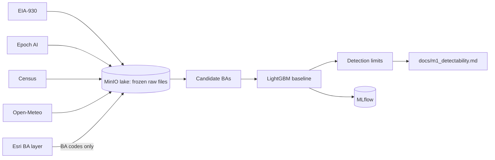

# AI Power Atlas

Is AI data center growth already visible in US grid demand, and where?

**Status: no finding yet.** This repo has finished its feasibility milestone, M1. It measured whether
a campus's load could be seen in hourly grid demand at all. It has not measured any campus's effect.
The event study that would answer the question is milestone M2, and it has not started.

## The problem

AI data centers now reach hundreds of megawatts to more than a gigawatt each. Grid operators report
demand by hour, so that growth should eventually show up in public data. Weather swings and other load
growth can hide a single campus, so a claim that one is "visible" needs a stated limit on what the data
could show in the first place.

## What M1 found

The result is a narrow go, recorded in [ADR-0002](docs/adr/0002-m1-go-or-pivot.md). Two sites in small
balancing authorities (BAs) are large enough to detect. In the three largest markets with a number,
PJM, ERCOT, and SOCO, no eligible campus is.

| Site | BA | Epoch power (MW) | Smallest detectable step (MW) | Share of power needed to be seen | Result |
|---|---|---:|---:|---:|---|
| Meta Kuna | IPCO | 198 | 98 | 49% | Passes |
| Meta Los Lunas | PNM | 147 | 77 | 52% | Passes |
| Anthropic-Amazon New Carlisle | PJM | 1,244 | 3,803 | 306% | Too small |
| Microsoft Fairwater Atlanta | SOCO | 859 | 1,678 | 195% | Too small |
| Colossus 2 | TVA | 1,276 | 846 | 66% | Large enough, but excluded for on-site power |
| OpenAI Stargate Abilene | ERCO | 865 | 2,675 | 309% | Too small, and flagged for on-site power |

Passing means these sites could be seen. It does not mean they were: no residual has been computed on
or after a real energization date. [All 15 series and 40 site-and-BA pairs](docs/m1_detectability.md)
are in the results file, including the failures.

New Carlisle clears the smaller AEP zone's 590 MW limit, at 47% of its power. That is a secondary
analysis, and by the plan's rule it cannot produce a go by itself. SWPP, AZPS, SRP, and WALC have too
little history before their first listed site to get a number.

## How it works

The method was committed to [docs/analysis_plan.md](docs/analysis_plan.md) before any model was fit,
and the git history shows the order. Changes are dated amendments at the end of that file.

1. **Choose BAs by rule.** A BA is a candidate if its listed site power is at least 2% of its peak
   hour in the last 12 months. 14 BAs qualified.
2. **Fit a weather baseline.** LightGBM predicts detrended demand from calendar and
   population-weighted weather. It uses no lagged demand, because lags would absorb the step being
   measured. Its settings are untuned starting values.
3. **Measure the noise.** Every 30 days, on windows that end before the BA's first listed site, the
   model trains on data up to a year before the date and predicts the next 545 days. The step estimate
   is the mean error in the 180 days after the date minus the mean in the 365 days before it.
4. **Compute the limit.** The smallest detectable step is the 95th percentile of those estimates minus
   the 20th, which gives a 5% false positive rate and 80% power. Injecting that step into real demand
   and re-measuring gave 77–80% detection at the limit. With no step, 5–8% of windows crossed the
   threshold.
5. **Apply the go test.** A site passes if it has no on-site power flag, sits in one BA polygon, and has
   power at or above that BA's limit.



## Baseline accuracy

Error is measured out of sample on each BA's newest window, up to 545 days ahead. The full table, with
RMSE and peak-hour error, is in [the results](docs/m1_detectability.md#baseline-against-benchmarks).

| BA | Model MAPE | Same hour last week | EIA day-ahead |
|---|---:|---:|---:|
| PGE | 3.3% | 7.4% | 1.5% |
| PNM | 4.0% | 6.3% | 6.6% |
| PACW | 4.0% | 7.9% | 4.0% |
| IPCO | 4.4% | 7.8% | 5.3% |
| TVA | 3.7% | 10.6% | 2.4% |
| BPAT | 3.9% | 6.9% | 2.1% |
| PJM | 3.9% | 7.8% | 3.6% |
| SOCO | 3.6% | 11.2% | 1.9% |
| ERCO | 3.4% | 8.6% | 2.6% |
| NEVP | 3.4% | 7.8% | 4.9% |

The model uses actual weather, which a real forecast would not have, so these are not forecasting
results. Its job is to normalize for weather.

## Limitations

- **Could, not did.** M1 says what could be detected, not what happened.
- **Rough limits.** Each estimate spans 545 days and the dates are 30 days apart, so a BA has far fewer
  independent windows than dates. SOCO's limit ranges from 503 to 2,388 MW on parts of its history, in
  a [sensitivity check](docs/m1_detectability.md#mde-sensitivity-not-pre-registered) that was added after
  the first run and is not part of the go test.
- **Sharp steps only.** The limit assumes a sudden step, and real campuses ramp up over months.
- **Estimated site data.** Epoch's power and dates are estimates from satellite imagery and permits, not
  metered load. The list is incomplete, and a site's first date can lag its real start.
- **On-site power.** Text search only finds what Epoch wrote. One flag, Colossus 1, was added by hand
  with a citation, and others may be missing.
- **Geography.** BA polygons overlap and do not match county lines. 24 of 60 sites are placed by a ZIP
  centroid, and weather is a county-centroid approximation. SRP's weather is one county.
- **Data quality.** EIA-930 revises recent hours and has gaps and spikes. WACM stopped reporting on
  2026-04-02, so it is out.
- **Attribution.** Detecting load would not by itself show that a data center caused it. M2 needs
  placebo dates and placebo BAs for that.
- **Kuna's timing.** Its full 180-day window is not complete until about 2026-11-28, after this freeze.

## Run it

Needs git, make, uv, and Docker with Compose v2. On macOS with Colima, run `colima start` after a
reboot. Give the VM at least 4 GB.

```bash
git clone https://github.com/VijayChamakuri/ai-power-atlas.git
cd ai-power-atlas
make setup
```

`make setup` creates `.env`. Add a free [EIA API key](https://www.eia.gov/opendata/register.php) before
running the pipeline. `make sources-check` also needs a free
[Census key](https://api.census.gov/data/key_signup.html) and a contact address for SEC EDGAR.

```bash
make up
make ci
make pipeline
```

| Command | What it does |
|---|---|
| `make up` | Starts Postgres, MinIO, Airflow, and MLflow |
| `make ci` | Runs ruff, `mypy --strict`, and the tests, with network access blocked |
| `make pipeline` | Pulls every source and runs the analysis, writing `docs/m1_detectability.md` |
| `make sources-check` | Rewrites `docs/source_status.md`. Exits 1 while LBNL and FCC block scripted requests |

Local services: MLflow at <http://localhost:5001>, Airflow at <http://localhost:8080>, and the MinIO
console at <http://localhost:9001>. Default local passwords are in `.env.example`. All ports bind to
loopback.

`make pipeline` took 63 minutes on an 8 GB MacBook, most of it the EIA pull. A rebuild from a fresh
clone and an empty lake on 2026-11-01 [reproduced every number](docs/log.md#clean-rebuild-2026-11-01) in
the results file.

The raw data is not committed, so a new run pulls whatever the sources serve that day. The freeze date
in `src/atlas/config.py` sets the cutoff, but providers can revise history and Epoch updates its files,
so later runs can differ. [docs/log.md](docs/log.md) records the hashes of the frozen M1 inputs.

## Data sources

[docs/DATA_SOURCES.md](docs/DATA_SOURCES.md) has URLs, licenses, attribution, and known issues.

- [EIA-930 Hourly Grid Monitor](https://www.eia.gov/electricity/gridmonitor/): U.S. Energy Information
  Administration. Public domain.
- [Frontier Data Centers](https://epoch.ai/data/data-centers-documentation): Epoch AI. CC BY 4.0.
- [Open-Meteo](https://open-meteo.com/): CC BY 4.0.
- US Census Bureau geocoder, Gazetteer, and Population Estimates. Public domain.
- Esri `Balancing_Authorities_Summary` layer: Esri Master License Agreement. Used for lookups only, and
  the polygons are not stored or redistributed.

## Repo map

| Path | Contents |
|---|---|
| [docs/analysis_plan.md](docs/analysis_plan.md) | Pre-registered method and dated amendments |
| [docs/m1_detectability.md](docs/m1_detectability.md) | Generated results for every BA and site |
| [docs/adr/](docs/adr/) | Go or pivot decision |
| [docs/log.md](docs/log.md) | Build log, data hashes, and differences from the plan |
| [docs/PLAN.md](docs/PLAN.md) | Full project plan |
| `src/atlas/ingest/` | Source pulls, site table, and BA mapping |
| `src/atlas/contracts/` | Schema checks on raw data |
| `src/atlas/lake/` | Parquet read and write |
| `src/atlas/ml/` | Features, baseline, candidates, detectability, and report |
| `dbt/seeds/` | Hand-entered rows, each with a citation |
| `tests/` | Unit tests. Fixtures are recorded real responses and slices of real data |

## Roadmap

1. **M2, the event study.** Run IPCO and PNM as the primary test, with placebo dates, placebo BAs, and
   90% intervals. Before any residual is computed at a real start date, an amendment must fix the
   details and cite the serving utility for overlapping sites, starting with Meta-QTS Hillsboro 2. A null
   result gets published as a null result.
2. **M3, independent review** of the method and results.

Carbon, siting, and the app come only after the v1 finding ships. See
[docs/PLAN.md](docs/PLAN.md#13-milestones-and-gates-local-first-no-calendar).

## Author

Vijay Shankar Chamakuri. [MIT License](LICENSE).
