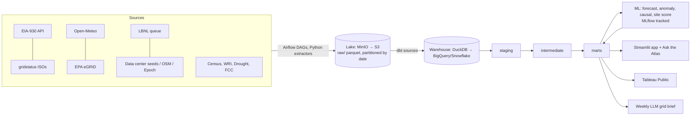

# AI Power Atlas — Build Plan

> **Hand-off doc for Codex / Claude Code.** Put this file at the repo root as `docs/PLAN.md`.
> Copy the "Agent Rules" section (§3) into both `AGENTS.md` (Codex) and `CLAUDE.md` (Claude Code).
> Owner and sole author: **Vijay Shankar Chamakuri**.

---

## 1. The headline question

> **Is AI data center growth already visible in US grid demand, and where?**

Everything in this project serves that one question. It is answered in versions, and each version must be finished and true before the next starts:

| Version | Question | Output |
|---|---|---|
| **v0 Feasibility** | Can a large campus's load be detected in hourly balancing authority (BA) data at all? | A minimum-detectable-MW number per BA and a go / pivot decision (ADR) |
| **v1 Headline** | Which BAs show demand growth that weather, calendar, and trend cannot explain, timed with known data center energizations? How many MW, how confident? | One chart, one number with a confidence interval, one method page |
| **v2 Consequence** | What does that growth mean for grid stress hours and carbon emissions? | Stress-hour and CO₂ deltas attributable to the growth |
| **v3 Decision** | Where should the next campus go, and when should flexible AI jobs run? | Siting score and carbon-aware scheduler |

**Primary reader:** a load-forecasting or resource-planning analyst at an Indiana utility, or a state regulator, who has to decide how much new demand to plan for. Secondary: data center developers, AI labs, and energy investors.

**Definition of done:** the README opens with the v1 finding (whatever it is, including "not detectable yet"), backed by a reproducible pipeline, a method page, and an independent review that tried and failed to break it. Every number links to the code that produced it.

---

## 2. Scope

### Core (v0 + v1) — must ship
- EIA-930 hourly demand, generation by fuel, and interchange for all BAs, plus weather.
- Epoch AI data center list mapped to BAs.
- Weather-normalized demand model and a detectability (power) analysis per BA.
- Event study / synthetic control around data center energization dates.
- dbt models, tests, and data quality report; a one-page Streamlit app showing the finding.
- `docs/analysis_plan.md` written **before** looking at results (hypothesis, method, success and failure criteria).

### Extensions (v2, v3) — only after v1 ships
- Hourly carbon intensity, stress-event detection, carbon-aware scheduler.
- County siting score.
- "Ask the Atlas" text-to-SQL and the weekly grid brief.
- Tableau Public executive dashboard, cloud deployment.

### Out of scope
- Real-time sub-hourly data, nodal price modelling, and international grids.
- Any paid or proprietary data source. **Everything must be reproducible from free public data.**
---

## 3. Agent Rules (copy into `AGENTS.md` and `CLAUDE.md`)

```markdown
# Agent Rules — AI Power Atlas

## Authorship (non-negotiable)
- Vijay Shankar Chamakuri is the ONLY author. Never add `Co-Authored-By`, `Claude-Session`,
  "Generated with ...", or any AI attribution to commits, PRs, code comments, or docs.
- Do NOT run `git commit` or `git push` unless explicitly told to. Default: stage changes and
  propose a Conventional Commit message; Vijay commits.
- Never change git config (user.name / user.email).

## Workflow
- Local-first. Everything must run with `make up && make pipeline && make test` on a laptop
  before anything touches the cloud or GitHub.
- Plan → test → implement → verify. Write or extend tests before or with each change.
- Small, reviewable changes: one concern per change, < ~400 changed lines.
- Before saying a task is done, run `make ci` and paste the summary. No "should work".

## Code standards
- Python 3.12, managed with `uv`. Type hints everywhere; `ruff` + `mypy --strict` must pass.
- SQL lives in dbt only (no SQL strings scattered in Python, except the guarded LLM layer).
  `sqlfluff` must pass.
- No secrets in code. Read from env vars via `pydantic-settings`; keep `.env.example` updated.
- No notebooks in `src/`. Notebooks only in `notebooks/`, outputs stripped (`nbstripout`).
- Every data source gets: a raw schema contract, a freshness check, and a row-count test.
- Log with `structlog` (JSON). No `print`.
- Do not invent data, metrics, or results. If a number is not computed from the pipeline,
  it does not go in the README.

## Real data only (non-negotiable)
- NEVER generate synthetic, mock, simulated, or "example" datasets. Every row must come from a
  source listed in docs/PLAN.md §7 and carry `_source`, `_source_url`, `_ingested_at` columns.
- If a source is unreachable, STOP and report it. Do not fabricate a fallback.
- Test fixtures = small slices of REAL API responses recorded with `vcrpy`/`pytest-recording`,
  stored in tests/fixtures/ with the date pulled.
- The demo dataset = a real 30-day extract produced by `make sample-data`, not generated.
- Any hand-curated row (e.g. a data center seed) must have a public citation URL.

## Anti-slop rules
- No placeholder functions, TODO stubs, or fake data presented as real.
- No emojis in code, logs, or commit messages.
- Prefer deleting code to adding abstraction. No class unless it holds state.
- Docstrings say WHY, not WHAT.
- README claims must link to the notebook, test, or dashboard that proves them.

## Things that make a repo read as AI-generated (avoid all of them)
Code:
- Comments that narrate the next line ("# Loop through the rows"). Comment only non-obvious decisions.
- Over-defensive try/except around everything, or catching bare `Exception` and logging "An error occurred".
- Wrapper classes, factories, and "managers" with one caller. Generic names: `utils.py`, `helpers.py`,
  `process_data()`, `handle_request()`, `DataProcessor`.
- Identical boilerplate docstrings on every function; Args/Returns blocks that repeat the type hints.
- Unused dependencies or imports, dead config flags, functions never called.
- Print-banner logging ("==== Starting pipeline ====") and emoji in logs or CLI output.
- Magic numbers with no source. Every threshold (z-score cutoff, weights) lives in config with a
  one-line reason.

Docs and README:
- Words to avoid: leverage, seamless, robust, cutting-edge, comprehensive, powerful, delve,
  unlock, empower, revolutionize, state-of-the-art, game-changer, "in today's fast-paced world".
- No emoji section headers, no badge walls (max 5 badges), no rocket emojis.
- No "Features" list of 15 bullet points. Show 3 results with numbers and a GIF instead.
- No "Future work" list longer than the shipped work.
- Write like an engineer's notes: short sentences, specific nouns, real numbers, stated limitations.
- Every chart has a title that states the finding ("MISO evening peak rose [X]% after [event]"), not
  "Demand over time".

Git:
- No single giant "Initial commit" containing the whole project. Commit as you build, in small steps.
- Never backdate or fake commit timestamps. An honest timeline is fine.
- Commit messages describe the change specifically: `feat(ingest): paginate EIA fuel-type pulls by
  month`, not `Update files` or `Implement comprehensive data pipeline`.
- No committed `.DS_Store`, `__pycache__`, `.env`, notebook outputs, or huge data files
  (data stays in the lake; a real sample Parquet under 20 MB is the only exception).

Analysis:
- Report baselines, errors, and failures alongside wins. Overly clean results are a red flag.
- State limitations in the README in plain words (EIA revisions, incomplete data center list,
  BA≠county).
```

---

## 4. Tools and software (complete list)

Pin exact versions in `uv.lock`, `package-lock.json`, and Docker image tags once installed. Use the latest stable release at setup time.

### 4.1 Local machine prerequisites
| Tool | Purpose |
|---|---|
| **Git** (2.40+) | Version control |
| **GitHub CLI** (`gh`) | Repo creation, PRs, releases |
| **Docker Desktop** (or OrbStack / Colima) + **Docker Compose v2** | Local services |
| **uv** | Python version + dependency manager |
| **Python 3.12** (installed via uv) | Core language |
| **Node.js 20+ LTS** + npm | `npx skills`, commitlint, markdownlint |
| **make** (or `just`) | Task runner |
| **VS Code** or Cursor + extensions: Python, Ruff, dbt Power User, Docker, YAML, Even Better TOML | Editor |
| **DBeaver** (or DuckDB CLI) | Browse the local warehouse |
| **Claude Code** and/or **Codex CLI** | Coding agents |
| **Tableau Public Desktop** (free) | Executive dashboard |
| **Loom** or OBS Studio | Demo video |
| **draw.io** / Excalidraw / Mermaid | Architecture diagrams |

### 4.2 Accounts and API keys (all free)
| Account | Use |
|---|---|
| **EIA Open Data API key** | EIA-930 hourly grid data, state prices |
| **GitHub** | Repo, Actions, Pages |
| **AWS** (free tier) | S3, Lambda, Glue Catalog, (optional) MWAA alternative |
| **Google Cloud** (free tier / sandbox) *or* **Snowflake** 30-day trial | Cloud warehouse target |
| **Anthropic API** or **OpenAI API** (a few dollars of credit), *or* **Ollama** locally for $0 | LLM layer |
| **Streamlit Community Cloud** | Free app hosting |
| **Tableau Public** | Free dashboard hosting |
| **Census API key** (optional) | ACS county data |

### 4.3 Local service stack (Docker Compose)
| Service | Role | Cloud equivalent |
|---|---|---|
| **MinIO** | S3-compatible data lake | AWS S3 |
| **DuckDB** (file) | Local warehouse | BigQuery or Snowflake |
| **Postgres 16** | Airflow and MLflow metadata | RDS |
| **Apache Airflow 2.x** (official compose or **Astro CLI**) | Orchestration | MWAA / Astronomer |
| **MLflow** | Experiment tracking + model registry | Managed MLflow / SageMaker |
| **Streamlit** | App | Streamlit Community Cloud |
| **Ollama** (optional) | Local LLM for $0 dev | Claude / OpenAI API |

### 4.4 Python libraries
- **Ingestion:** `httpx`, `tenacity` (retries), `gridstatus` (ISO data), `boto3`, `pyarrow`, `polars`, `pandas`
- **Config/validation:** `pydantic`, `pydantic-settings`, `pandera`
- **Warehouse/transforms:** `dbt-core`, `dbt-duckdb`, `dbt-bigquery` *or* `dbt-snowflake`, `duckdb`
- **Data quality:** dbt tests, `dbt-expectations` (package), `elementary-data` (dbt observability), `pandera`
- **ML/stats:** `scikit-learn`, `lightgbm`, `statsmodels` (STL, ARIMA), `scipy`, `shap`, `optuna`, `mlflow`, `pysyncon` or a hand-built synthetic control, `linearmodels` (DiD panel)
- **Geo:** `geopandas`, `shapely`, `h3`, `pydeck`
- **LLM:** `anthropic` and/or `openai`, `sqlglot` (SQL parsing + guardrails), `instructor` (structured output)
- **App/viz:** `streamlit`, `plotly`, `altair`, `pydeck`
- **Ops:** `structlog`, `typer` (CLI), `rich`
- **Dev:** `pytest`, `pytest-cov`, `hypothesis`, `ruff`, `mypy`, `pre-commit`, `sqlfluff`, `nbstripout`, `mkdocs-material`, `detect-secrets` or `gitleaks`

### 4.5 CI/CD and repo tooling
- **GitHub Actions**: lint → type-check → unit tests → dbt build on DuckDB with sample data → Docker build
- **pre-commit** hooks: ruff, mypy, sqlfluff, gitleaks, nbstripout, end-of-file, trailing whitespace, **custom commit-msg hook that strips AI trailers**
- **commitlint** (Conventional Commits)
- **release-please** (changelog + semantic versions)
- **Dependabot** (pip, GitHub Actions, Docker)
- **CodeQL** (security scanning)
- **MkDocs Material** → GitHub Pages (docs site + dbt docs)

---

## 5. Agent skills to install (public, free)

**Review every third-party skill's `SKILL.md` before installing.** Skills are instructions plus scripts that your agent will run.

### 5.1 Claude Code
```text
# Official Anthropic skills (frontend-design, webapp-testing, skill-creator, pdf, docx, xlsx, mcp-builder ...)
/plugin marketplace add anthropics/skills

# Superpowers: brainstorming, writing-plans, executing-plans, test-driven-development,
# systematic-debugging, verification-before-completion, requesting-code-review
/plugin marketplace add obra/superpowers-marketplace
/plugin install superpowers@superpowers-marketplace

# dbt Labs official agent skills: analytics engineering, running dbt commands,
# mermaid DAGs, natural-language questions with dbt
/plugin marketplace add dbt-labs/dbt-agent-skills
/plugin install dbt@dbt-agent-marketplace
```

### 5.2 Codex
Codex reads the same open `SKILL.md` standard. Install the skills into the repo so both agents share them:
```bash
npx skills add dbt-labs/dbt-agent-skills
npx skills add obra/superpowers
npx skills add anthropics/skills --skill webapp-testing
npx skills add anthropics/skills --skill frontend-design
# or copy folders manually into .agents/skills/ (Codex) and .claude/skills/ (Claude Code)
```
Also browse `github.com/openai/skills` for Codex-native skills.

### 5.3 When each skill is used
| Step | Skill |
|---|---|
| Kickoff / design | `superpowers:brainstorming`, `superpowers:writing-plans` |
| Every feature | `superpowers:test-driven-development`, `superpowers:executing-plans` |
| dbt models | `dbt:using-dbt-for-analytics-engineering`, `dbt:running-dbt-commands` |
| Lineage docs | `dbt:creating-mermaid-dbt-dag` |
| Ask the Atlas | `dbt:answering-natural-language-questions-with-dbt` (reference pattern) |
| Bugs | `superpowers:systematic-debugging` |
| Streamlit UI polish | `frontend-design`, `webapp-testing` (Playwright smoke tests) |
| Before each merge | `superpowers:requesting-code-review`, `superpowers:verification-before-completion` |
| Project-specific | Use `skill-creator` to write **one custom skill**: `atlas-data-contracts` (how to add a new source, end to end). This is also a portfolio talking point. |

---

## 6. Sole-authorship setup (do this before the first commit)

```bash
# 1. Identity — repo-local, so nothing else can override it
git config user.name  "Vijay Shankar Chamakuri"
git config user.email "vijaychamakuri1558@gmail.com"   # must match a verified GitHub email

# 2. Claude Code: disable attribution (user level AND project level)
#    ~/.claude/settings.json and .claude/settings.json
{
  "attribution": { "commit": "", "pr": "" }
}
```

**3. A commit-msg hook as a hard backstop.** Some agent versions still add a `Claude-Session:` trailer even with attribution disabled, so strip all AI trailers at commit time.
`scripts/hooks/strip-ai-trailers.sh`:
```bash
#!/usr/bin/env bash
# Remove AI attribution trailers so Vijay is the sole author.
sed -i.bak -E '/^(Co-[Aa]uthored-[Bb]y:.*|Claude-Session:.*|.*Generated with \[?(Claude|Codex).*)$/d' "$1"
rm -f "$1.bak"
```
Register it in `.pre-commit-config.yaml` as a `commit-msg` stage hook, then run `pre-commit install --hook-type commit-msg --hook-type pre-commit`.

**4. A CI guard** (`.github/workflows/authorship.yml`). It fails the build if any commit has a different author or an AI trailer:
```bash
git log --format='%an <%ae>%n%(trailers)' --all \
  | grep -Ev '^(Vijay Shankar Chamakuri <vijaychamakuri1558@gmail.com>)?$' && exit 1 || exit 0
```

**5. Verify before every push:**
```bash
git log --format='%h %an <%ae> | %(trailers:only,unfold)' | sort -u -k2
```

---

## 7. Data sources — 100% real, public, free (no synthetic data anywhere)

### 7.1 Core sources (verified October 2026)

| # | Source | Exact access | What you get | Grain / history | Refresh | License |
|---|---|---|---|---|---|---|
| 1 | **EIA-930 Hourly Grid Monitor** | API v2: `https://api.eia.gov/v2/electricity/rto/region-data/data/` (demand, EIA forecast, net gen, interchange), `.../rto/fuel-type-data/data/` (gen by fuel), `.../rto/interchange-data/data/`, `.../rto/region-sub-ba-data/data/`. Free key: eia.gov/opendata. Max 5,000 rows/call → paginate with `offset`. | Demand, day-ahead demand forecast, generation by fuel, BA-to-BA flows | Hourly × ~65 BAs, from **July 2015** | Hourly | US Gov public domain |
| 2 | **Epoch AI — Frontier Data Centers** | CSV: `https://epoch.ai/data/data_centers/data_centers.csv` (docs: epoch.ai/data/data-centers-documentation). Also `gpu_clusters.csv`. | Large AI data centers: owner, location, power (MW), compute, construction timeline from satellite + permits | Site × time | ~Monthly | CC BY 4.0 |
| 3 | **LBNL "Queued Up"** | Excel data file at `https://emp.lbl.gov/queues` (2026 edition, data through end-2025) | ~8,200 active interconnection requests: type, MW, county, ISO, status, dates. ~98% of US capacity | Project | Annual | CC BY 4.0 (credit LBNL + GridTracker) |
| 4 | **EPA eGRID** | Excel download from epa.gov/egrid | CO₂ emission rates by plant, fuel, subregion | Annual | Annual | Public domain |
| 5 | **EIA-923 / EIA-860** (via API or `gridstatus`) | `electricity/facility-fuel`, `electricity/operating-generator-capacity` | Plant-level generation, fuel use, capacity; to derive fuel emission factors and planned plants | Monthly × plant | Monthly | Public domain |
| 6 | **ISO market data via `gridstatus`** (open-source Python) | `gridstatus.MISO()`, `.PJM()`, `.Ercot()`, `.SPP()` | Real-time and day-ahead **LMP prices**, load, fuel mix, sub-hourly | 5-min/hourly | Live (history varies by ISO) | Public ISO data |
| 7 | **Open-Meteo Historical + Forecast** | `archive-api.open-meteo.com/v1/archive`, `api.open-meteo.com/v1/forecast` (no key) | Temperature, humidity, wind at BA population centroids | Hourly, 1940→now | Daily | CC BY 4.0 |
| 8 | **EIA retail electricity prices** | API v2 `electricity/retail-sales` | Industrial ¢/kWh by state | Monthly × state | Monthly | Public domain |
| 9 | **WRI Aqueduct 4.0** | Download from wri.org/aqueduct | Baseline water stress | Sub-basin | Static | CC BY 4.0 |
| 10 | **US Drought Monitor** | `usdmdataservices.unl.edu` REST (county statistics) | Drought category % area | Weekly × county | Weekly | Public |
| 11 | **FCC National Broadband Map** | broadbandmap.fcc.gov data download | Fiber availability | Location → county | Semi-annual | Public |
| 12 | **Census TIGER/Line + ACS 5-yr** | `www2.census.gov/geo/tiger/`, `api.census.gov` | County shapes, population, centroids | County | Annual | Public domain |
| 13 | **HIFLD / EIA Control Areas shapefile** | EIA "Balancing authorities" map layer / HIFLD open data | BA service-territory polygons for the county↔BA crosswalk | Polygon | Annual | Public |
| 14 | **SEC EDGAR XBRL** (stretch) | `data.sec.gov/api/xbrl/companyconcept/...` (set a User-Agent with your email) | Hyperscaler capex (MSFT, GOOGL, META, AMZN, ORCL) | Quarterly | Quarterly | Public |
| 15 | **OpenStreetMap via Overpass** (supplement) | `overpass-api.de` query `telecom=data_center` / `building=data_center` | Smaller data center footprints not in Epoch | Site | Live | ODbL (attribute OSM) |

**Expected volume:** EIA-930 alone is tens of millions of real hourly rows across demand, fuel types, and interchange since 2015. State the real row count from the pipeline, not an estimate.

### 7.2 Sourcing runbook (what the agent builds in M0–M1)
1. `atlas sources check`: pings every source and writes `docs/source_status.md` (reachable, last-updated date, row count). Run it first.
2. **EIA backfill:** one month per request window × BA, paginated by `offset`, retried with `tenacity`, written to `raw/eia/{dataset}/year=/month=/`. It is idempotent, so a re-run overwrites the same partition.
3. **Incremental:** an Airflow DAG pulls the last 72 h every hour, because EIA revises recent hours, then dedupes in dbt on `(ba, period, type)` keeping the latest `_ingested_at`.
4. **File sources** (Epoch, LBNL, eGRID, Aqueduct, TIGER): a downloader stores the original file with a SHA-256 hash in `raw/files/{source}/{date}/`. Parsing happens later, so the original is always kept.
5. **Lineage columns** on every raw table: `_source`, `_source_url`, `_ingested_at`, `_file_sha256`.
6. **`docs/DATA_SOURCES.md`**: one section per source with the URL, license, attribution text, refresh cadence, known issues, and the date last pulled. Add a citation block in the README.
7. **Hand-curated seeds** (only where public data is thin, e.g. Indiana AI campuses): each row needs `source_url`, `source_type` (permit, utility filing, press release), and `confidence` (`reported`/`announced`/`estimated`). A dbt test fails if `source_url` is null.

**Known data problems (must be handled and documented in `docs/data_quality.md`):**
- EIA-930 has gaps, negative values, spikes, and late revisions. Build an `int_eia_cleaned` model that flags and imputes, and keep both raw and clean values.
- BA boundaries ≠ counties. Build a county→BA crosswalk with an explicit method and limitations.
- Data center lists are incomplete. Label MW figures as *announced*, *estimated*, or *reported*, and never present estimates as facts.

---

## 8. Architecture



**Environments**
- `local`: MinIO + DuckDB + Airflow in Docker. **All development happens here.**
- `cloud`: S3 + BigQuery (or Snowflake) + Airflow (Astro free tier or a small VM) + a Lambda for daily EIA pulls. Switch with `ATLAS_ENV=cloud`. The same dbt project uses a different `profiles.yml` target.

---

## 9. Repository structure (industry level)

```
ai-power-atlas/
├── .github/
│   ├── workflows/ (ci.yml, authorship.yml, docs.yml, release.yml, codeql.yml)
│   ├── ISSUE_TEMPLATE/ (bug.yml, feature.yml, data_source.yml)
│   ├── PULL_REQUEST_TEMPLATE.md
│   ├── CODEOWNERS
│   └── dependabot.yml
├── .agents/skills/            # Codex skills (committed)
├── .claude/ (settings.json, skills/)
├── AGENTS.md  CLAUDE.md
├── README.md  LICENSE (MIT)  CHANGELOG.md  CONTRIBUTING.md  SECURITY.md  CODE_OF_CONDUCT.md
├── Makefile  pyproject.toml  uv.lock  .env.example  .pre-commit-config.yaml  .sqlfluff
├── docker/ (airflow/, mlflow/, app/) and docker-compose.yml
├── dags/                      # Airflow DAGs only; logic imported from src
├── src/atlas/
│   ├── config.py
│   ├── ingest/ (eia.py, gridstatus_iso.py, weather.py, egrid.py, queue.py, datacenters.py, geo.py)
│   ├── lake/ (io.py — S3/MinIO parquet read/write)
│   ├── contracts/ (pandera schemas per source)
│   ├── ml/ (features.py, forecast.py, anomaly.py, causal.py, site_score.py, scheduler.py)
│   ├── llm/ (ask.py, guardrails.py, brief.py, prompts/)
│   └── cli.py                 # `atlas ingest eia --start ...`
├── dbt/
│   ├── models/staging/ intermediate/ marts/
│   ├── seeds/ (major_ai_datacenters.csv, eia_ba_metadata.csv, emission_factors.csv)
│   ├── tests/  macros/  snapshots/
│   └── models/semantic/ (metrics definitions)
├── app/ (Home.py, pages/1_Grid_Stress.py, 2_Carbon_Clock.py, 3_Site_Selector.py, 4_Ask_the_Atlas.py)
├── notebooks/ (01_eda.ipynb, 02_forecast_backtest.ipynb, 03_causal_dc_load.ipynb)
├── tests/ (unit/, integration/, llm_evals/, app_smoke/)
├── docs/ (PLAN.md, architecture.md, data_quality.md, model_cards/, adr/, case_study.md)
├── dashboards/tableau/ (workbook .twbx + extract notes)
└── scripts/ (bootstrap.sh, hooks/strip-ai-trailers.sh, sample_data.py)
```

**Makefile targets:** `setup`, `up`, `down`, `ingest`, `dbt-build`, `train`, `app`, `test`, `lint`, `ci`, `docs`, `sample-data`, `clean`.

**Repo hygiene:**
- Protected `main` branch, with work on feature branches named `feat/…`, `fix/…`, `chore/…`
- Conventional Commits and squash-merge PRs, even when solo, so the history looks professional
- Semantic version tags, e.g. `v0.1.0` (MVP) and `v1.0.0` (launch)
- ADRs in `docs/adr/`, such as `0001-duckdb-local-bigquery-cloud.md` and `0002-carbon-intensity-method.md`
- README badges: CI, coverage, license, docs, live demo

---

## 10. Data model (dbt)

**Staging (1:1 with sources, renamed and typed):** `stg_eia__demand`, `stg_eia__generation_by_fuel`, `stg_eia__interchange`, `stg_weather__hourly`, `stg_egrid__factors`, `stg_queue__projects`, `stg_datacenters__sites`, `stg_geo__counties`, …

**Intermediate:**
- `int_eia_cleaned` (gap fill, outlier flags, revision handling)
- `int_ba_weather` (population-weighted temperature per BA)
- `int_carbon_intensity_hourly` (Σ generation_by_fuel × emission factor ÷ total generation, in gCO₂/kWh)
- `int_county_ba_crosswalk`
- `int_dc_capacity_by_ba` (MW announced/operational over time)

**Marts:**
| Model | Grain | Key columns |
|---|---|---|
| `dim_balancing_authority` | BA | name, ISO, states, timezone |
| `dim_county` | county | FIPS, population, state, BA |
| `fct_grid_hourly` | BA × hour | demand, forecast_eia, net_gen, fuel mix %, temp, carbon_intensity |
| `fct_grid_stress_events` | event | BA, start, end, severity, z-score, reserve proxy, cause tag |
| `fct_demand_forecast` | BA × hour × horizon | our forecast, EIA's forecast, actual, error |
| `fct_detectability` | BA | minimum detectable MW step, residual noise, method version |
| `fct_dc_load_impact` | BA × DC event | estimated MW added, CI, placebo p-value, method |
| `mart_site_scores` | county | sub-scores, final score, rank, sensitivity band |
| `mart_carbon_schedule` | BA × hour-of-week | expected intensity, cleanest windows |

**Tests:** unique/not-null on keys, accepted ranges (demand > 0, intensity 0–1500 g/kWh), freshness on every source, relationship tests, row-count anomaly tests (elementary), and a fuel mix that sums to roughly 100%.

**Semantic metrics:** `avg_carbon_intensity`, `peak_demand`, `stress_hours`, `forecast_mape`, `site_score`.

---

## 11. Analytics and ML modules

### 11.0 Headline analysis (core — build this first)
1. **Candidate BAs, chosen by data, not by hand:** BAs where Epoch-listed campus power is a meaningful share of BA peak demand (start with a threshold such as 2%, recorded in config with the reason). Smaller BAs give better signal than PJM-sized ones.
2. **Weather-normalized baseline:** fit demand on temperature, humidity, calendar, holidays, and trend using only the period *before* each energization date. The forecasting model in 11.1 doubles as this baseline.
3. **Detectability (power) analysis:** inject known MW step changes into real historical residuals and measure the smallest step the method reliably detects per BA. This is the v0 gate. If a campus is below the detectable size, say so; do not claim it.
4. **Event study:** residual demand before vs. after energization, with placebo dates and placebo BAs.
5. **Synthetic control:** build a weighted combination of untreated BAs that tracks the treated BA pre-period; the post-period gap is the estimate.
6. **Output:** MW estimate, 90% interval, placebo results, and a plain-English limitations section. A null result is published as a null result.

Modules 11.1–11.6 below support or extend the headline. Build them in the order the milestones in §13 allow.

### 11.1 Demand forecasting
- **Target:** hourly demand per BA, 1–168 h ahead.
- **Baselines (must beat):** seasonal naive (same hour last week) and **EIA's own day-ahead forecast**.
- **Model:** LightGBM. Features: lags, rolling stats, calendar, holidays, temperature, cooling and heating degree hours, and data center capacity.
- **Validation:** rolling-origin time-series CV. Report MAPE, RMSE, and peak-hour error per BA.
- **Track** every run in MLflow, register the best model, and publish a model card in `docs/model_cards/`.

### 11.2 Grid-stress anomaly detection
- STL decomposition, then robust z-score on residuals, plus Isolation Forest on a multivariate input (demand, interchange, price, intensity).
- Severity tiers. Label a set of known historical events (e.g., Winter Storm Elliott, Dec 2022) and report precision/recall against them.

### 11.3 Data center load impact
Implemented as part of the headline analysis in 11.0 (event study + synthetic control). Optional cross-check: difference-in-differences panel with `linearmodels`, reported only if it agrees in direction; if it disagrees, report both and explain.

### 11.4 Carbon-aware scheduler
- **Input:** a job (e.g., a 72 h training run of 20 MW, which may start within 7 days, in a chosen region).
- **Output:** the best start time and region, the tons of CO₂ saved versus running immediately, and the cost delta using the price data.
- **Backtest** across one year and report the average % reduction.

### 11.5 Site selection score
- Sub-scores per county:
  - grid headroom (queue congestion, reserve margin proxy)
  - carbon intensity
  - industrial power price
  - water stress
  - drought
  - fiber availability
  - climate (cooling degree days)
  - existing DC cluster proximity
- Normalize the sub-scores, apply weights, and let users drag the weights in the app.
- **Sensitivity analysis:** Monte Carlo over the weights, so each county shows a rank band rather than one fake-precise number.

### 11.6 LLM layer
**Ask the Atlas** (text-to-SQL):
- Uses only the allowlisted marts and their documented columns from the dbt manifest.
- `sqlglot` parses every query. Allow SELECT only, reject DDL/DML, auto-add `LIMIT`, and use a read-only DuckDB connection with a timeout.
- Show the generated SQL, the result table, a chart, and an explanation.
- **Evals:** `tests/llm_evals/questions.yaml` holds 40 questions with gold SQL or answers. Report execution accuracy in the README and fail CI if it drops below a threshold. Run against Ollama in CI, or skip and run locally.

**Weekly Grid Brief:**
- Built from the marts, with structured output via `instructor`.
- Every number in the brief must come from a query result, never from the model. Assert this in a test.

---

## 12. App and dashboards

**Streamlit pages:**
1. **Grid Stress:** a US map of BAs colored by current stress, plus a time series with anomalies and the forecast vs. actual.
2. **Carbon Clock:** a heatmap of hour-of-week × BA intensity, plus the scheduler form.
3. **Site Selector:** a county choropleth with weight sliders, a top-20 table, and the sensitivity band.
4. **Ask the Atlas:** chat with SQL shown.
5. **Methodology:** the data sources, limits, and model cards.

**Tableau Public executive dashboard:** KPI tiles (peak demand, stress hours, avg intensity, forecast MAPE), a BA map, a trend panel, and site rankings. Publish it and link it from the README.

**Quality bar:** use the `frontend-design` skill, add Playwright smoke tests via `webapp-testing`, and target a cold load under 3 s from cached marts.

---

## 13. Milestones and gates (local first, no calendar)

Coding agents make the code fast. The slow, important parts are data backfills, and checking whether results are true. **Do not skip a gate to save time.** Each milestone ends with passing `make ci`, a tagged commit, and a short note in `docs/log.md` stating what was learned. Nothing goes to GitHub until M0 is green locally; the repo stays private until M5.

**What Vijay provides:** the machine and compute (long backfills and model runs may run for hours; run them in the background with `tmux` or as Airflow tasks and log progress to `logs/`), all accounts and API keys from §4.2, permission for the agent to use the terminal, Docker, and browser when a download needs it, and his decision at each gate.

| Milestone | Deliverables | Gate to pass before moving on |
|---|---|---|
| **M0 Foundation** | Repo skeleton, uv, Makefile, pre-commit, authorship hook, docker-compose (MinIO, Postgres, Airflow, MLflow), AGENTS.md/CLAUDE.md, skills installed, `atlas sources check` | Clean clone runs `make setup && make up`; every source in §7 reachable; `git log` shows only Vijay |
| **M1 Feasibility spike** | Minimal EIA + weather + Epoch ingest for candidate BAs, baseline model, detectability analysis (11.0 steps 1–3), `docs/analysis_plan.md` | **ADR-0002: go / pivot.** Go if at least one campus is above its BA's detectable size. Pivot options: (a) restrict to small BAs, (b) aggregate many campuses per ISO, (c) lead with carbon (v2) instead |
| **M2 MVP (v1 headline)** | Full ingest + Airflow DAG, dbt staging → marts with tests, event study + synthetic control, one-page Streamlit app with the headline chart, draft README | The finding reproduces from a clean clone with `make pipeline`; placebo tests reported |
| **M3 Independent review** | A fresh agent session with no build context (use the *other* agent: Codex reviews Claude Code's work or the reverse) audits `docs/analysis_plan.md` vs. what was run, re-runs the pipeline from a clean clone, and tries to break the finding (different weather source, shifted energization dates, other candidate BAs). It also cross-checks key figures against published sources (EIA reports, Epoch AI, LBNL) with citations. Output: `docs/review.md` | Every issue is fixed or stated as a limitation in the README; the headline survives the robustness checks or is revised |
| **M4 Extensions (v2, v3)** | Carbon intensity, stress events, scheduler, siting score, Ask the Atlas with evals, Tableau | Each extension has tests, a method note, and does not change the headline result without explanation |
| **M5 Launch** | Cloud target (S3 + BigQuery/Snowflake + Lambda), deployed app, docs site, `v1.0.0` release, written post with one chart, 2-minute video | Live app with fresh data; repo public; post published and linked from README |

### First prompt to give the agent
```text
Read docs/PLAN.md and AGENTS.md fully. Use the superpowers brainstorming and writing-plans
skills to turn Milestone M0 into a step-by-step implementation plan with tests. Show me the
plan before writing code. Do not commit; stage changes and propose commit messages.
```
Then one milestone per session: *"Execute milestone M[N] of docs/PLAN.md using test-driven-development. Stop at the gate, show `make ci` output, and summarize what the data showed."* At M1, the agent must stop and wait for Vijay's go / pivot decision.

---

## 14. README skeleton (fill only with real results)

1. A title and a one-line pitch, followed by badges and a **live demo link + GIF**
2. **The problem:** AI load growth vs. grid capacity and carbon, in 3 sentences
3. **The finding:** one chart and one sentence answering the headline question, with the MW estimate and interval (or the honest null)
4. **How we know:** method summary, placebo results, detectability limits, link to `docs/analysis_plan.md`
5. **Results table for supporting work:** forecast error vs. baselines and EIA's forecast, then extension results
6. Robustness checks and independent review summary (from `docs/review.md`)
7. Architecture diagram
8. Quickstart: `git clone … && make setup && make up && make sample-data && make app`
9. Data sources and limitations
10. Repo map
11. Model cards + ADR links
12. A Roadmap, and an author section with Vijay's links

---

## 15. Suggestions to make it even better

**High impact**
0. **Pre-register the analysis.** Write the hypothesis, method, and what counts as success or failure in `docs/analysis_plan.md` before running it, and commit it first. Git history then proves you did not tune the method to get a result. Few portfolio projects do this.
1. **Indiana deep-dive page.** Cover the planned AI campuses in Indiana, the MISO/PJM split across the state, and what they mean for Indiana rates.
2. **Publish the headline finding as an article.** One chart, one number, one paragraph on method, one on limits. Use the form "In [BA], demand not explained by weather grew [measured MW] after [campus] came online", filled only with measured values. Post it on LinkedIn and Medium and link it to the repo. A finding beats a repo.
3. **Compare against EIA's own forecast.** Beating or matching the government benchmark is a headline recruiters remember.
4. **A data contract skill (`atlas-data-contracts`).** It shows you can make AI agents productive on your codebase, and it gives you something concrete to discuss in interviews.
5. **Public API.** A small FastAPI endpoint, `/carbon/best-window?region=MISO&hours=72`, makes the project a product other people can use.

**Engineering polish**
6. Run incremental dbt models and slim CI (`state:modified+`) to show you understand cost.
7. Add data observability (elementary) and a public "data freshness" badge.
8. Write cost notes in `docs/cost.md` covering monthly cloud spend, under $10 with the free tier.
9. Add a `make demo` that runs entirely from a bundled **real** 30-day extract, saved as Parquet from the actual pipeline, with no API keys needed. Reviewers will actually try it.
10. Add OpenLineage/Marquez for lineage, as an optional extra.

**Analytics depth**
11. Show prediction intervals with quantile LightGBM or conformal prediction instead of point forecasts only.
12. Add marginal emissions (approximated from fuel-on-the-margin), not just average emissions. Explain the difference in an ADR. Energy people will notice.
13. Add a scenario simulator: "Add a 1 GW campus to BA X — how many more stress hours per year?"
14. Add an LLM-on-filings module that extracts capex and data center announcements from SEC 10-Qs with structured output and links them to grid data.

**Career leverage**
15. Write a two-page case study PDF for applications, with the business problem, approach, numbers, and screenshots.
16. Tailor your resume bullets from real results, for example: "Built an end-to-end grid analytics platform (Airflow, dbt, BigQuery, LightGBM) over [actual row count] hourly records…". Use the real count from `dbt` and never round up.
17. Record the two-minute demo video, and pin it on GitHub and LinkedIn.

---

## 16. Risks and mitigations

| Risk | Mitigation |
|---|---|
| EIA API rate limits or outages | Cache raw pulls in the lake; backfill in chunks; retries with backoff |
| Data center MW data is unreliable | Tag the confidence level; use announced vs. operational; keep claims modest |
| Data center load is too small to detect | M1 detectability gate decides before heavy build; pivot options in ADR-0002 |
| Energization dates are uncertain | Use Epoch timelines plus permit or utility filing dates; test sensitivity to ±3 months |
| Causal estimate is noisy | Report the interval and placebos; frame it as "evidence," not proof |
| Scope creep | Nothing from v2/v3 starts until the v1 finding ships (§2) |
| Agent speed hides weak analysis | Gates in §13 require Vijay to read results and decide; the agent never self-approves a gate |
| LLM hallucinated numbers | Numbers only from query results; test enforced |
| Cloud bill | Free tiers, budget alerts in AWS/GCP, DuckDB for dev |
| AI attribution sneaks into git | Settings + commit-msg hook + CI guard (§6) |
